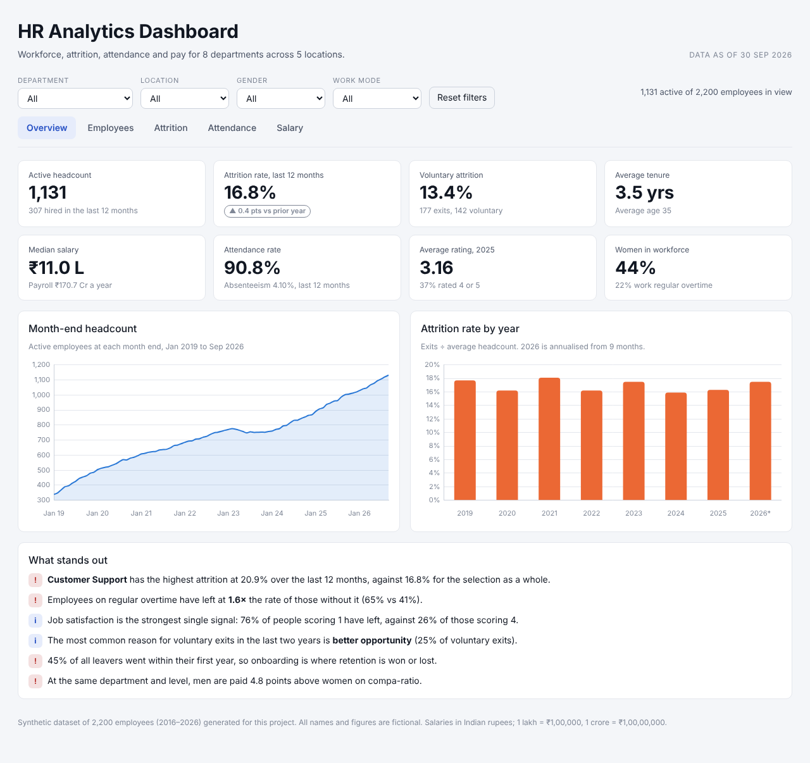
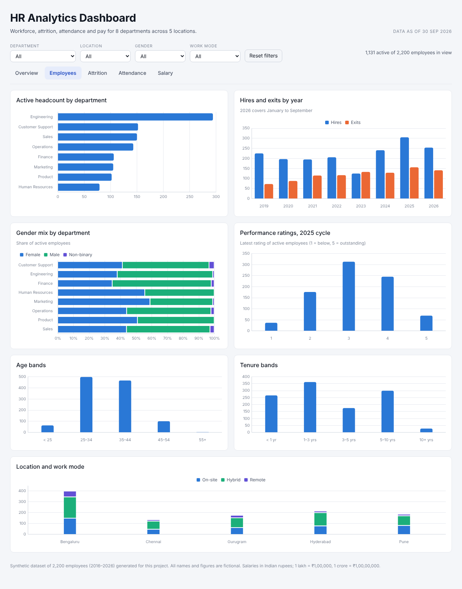
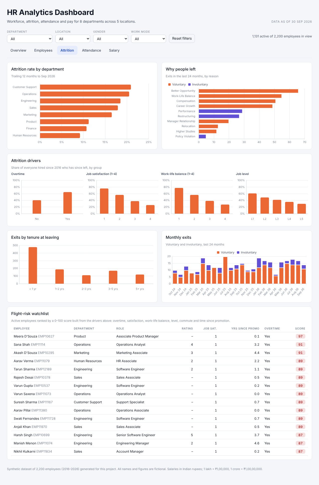
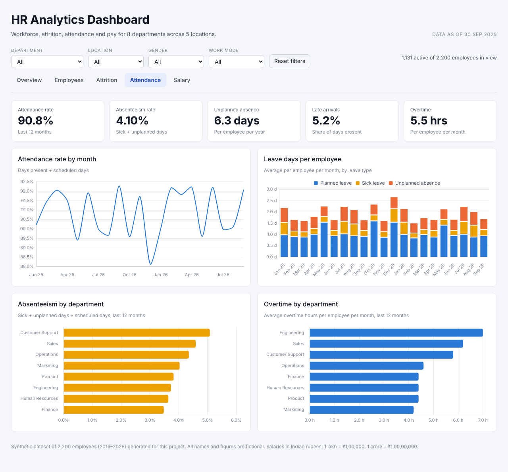
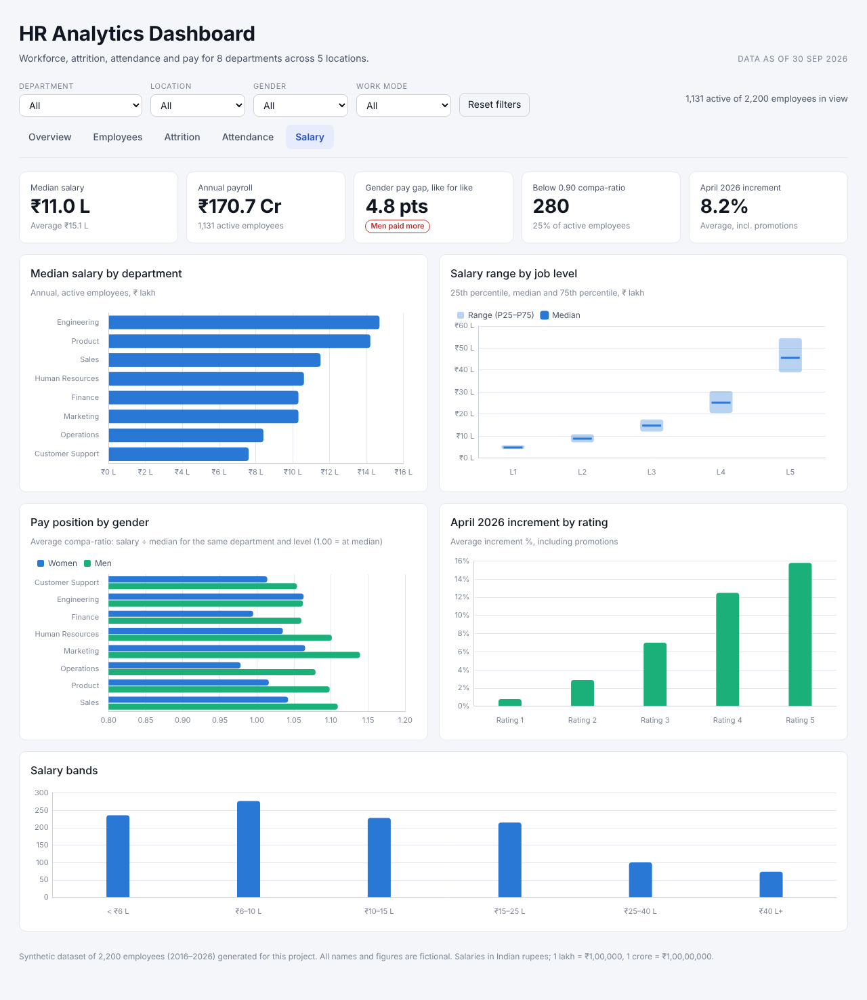

# HR Analytics Dashboard

An end-to-end HR analytics project that helps HR teams make data-driven decisions about their workforce. It covers employee analytics, attrition, attendance, salary and KPI reporting, using SQL for the analysis, an interactive dashboard for exploration, and a written report for leadership.



## What's inside

| Deliverable | Where |
|---|---|
| HR dataset (synthetic, 2,200 employees, 2016–2026) | [`data/`](data/) · [data dictionary](docs/data_dictionary.md) |
| SQL scripts: schema, load, views, analysis queries, KPIs (PostgreSQL) | [`sql/`](sql/) |
| Interactive dashboard (HTML + Chart.js, no server needed) | [`dashboard/index.html`](dashboard/index.html) |
| Power BI build kit: Power Query, DAX measures, theme, page layout | [`powerbi/`](powerbi/) |
| HR Analytics Report (PDF) | [`report/HR_Analytics_Report.pdf`](report/HR_Analytics_Report.pdf) |
| Python scripts to regenerate everything | [`scripts/`](scripts/) |

## Key features

* **Employee analytics:** headcount trend, department and location mix, gender, age and tenure distribution, performance ratings
* **Attrition analysis:** annual and trailing-12-month attrition, by department, exit reasons, attrition drivers, first-year exits, cohort retention and a flight-risk watchlist
* **Attendance analysis:** attendance and absenteeism rates, leave mix, late arrivals, overtime, Bradford factor, absence before exit
* **Salary insights:** pay by department and level, compa-ratio, adjusted gender pay gap, increments by performance rating, payroll trend
* **Interactive dashboard:** five tabs with filters for department, location, gender and work mode; every KPI and chart recalculates on the fly
* **KPI reporting:** one SQL script and one dashboard strip with the 15 headline HR KPIs

## Headline results (as of 30 Sep 2026)

| KPI | Value |
|---|---|
| Active headcount | 1,131 |
| Attrition rate, trailing 12 months | 16.8% (13.4% voluntary) |
| New hires, trailing 12 months | 307 |
| Average tenure | 3.5 years |
| Median salary | ₹11.0 lakh |
| Attendance rate | 90.8% |
| Absenteeism rate | 4.10% |
| Adjusted gender pay gap | 4.8 compa-ratio points |

**Findings**

1. Customer Support and Operations lose people fastest (about 21% a year), Human Resources and Finance the slowest (about 10%).
2. Employees on regular overtime have left at 1.6× the rate of those without it.
3. Job satisfaction and work-life balance are the strongest signals: 76% of people with satisfaction 1 have left, against 26% at satisfaction 4.
4. 45% of all leavers go within their first year.
5. At the same department and level, women are paid about 4.8 points below men on compa-ratio, a gap set at hiring rather than through increments.
6. Unplanned absence roughly doubles in a leaver's final three months, which makes it a useful early-warning signal.

The full write-up and recommendations are in the [HR Analytics Report](report/HR_Analytics_Report.pdf).

## Dashboard

Open `dashboard/index.html` in any browser. It loads Chart.js and two Google Fonts from a CDN and embeds the data, so it works without a server.

| Employees | Attrition |
|---|---|
|  |  |
| **Attendance** | **Salary** |
|  |  |

The page follows the system light/dark setting.

### Deploy on Netlify

The repository is ready for Netlify: `netlify.toml` publishes the `dashboard/` folder as a static site, with no build step.

1. In Netlify choose **Add new site → Import an existing project → GitHub** and pick this repository.
2. Leave the build settings as they are (they are read from `netlify.toml`) and click **Deploy**.

Every push to `main` redeploys the site. After changing the data, run `make dashboard` and commit the rebuilt `dashboard/index.html`.

### Power BI

`.pbix` files are binary and must be saved from Power BI Desktop, so this repository ships the full build kit instead: Power Query scripts for every table, 40+ DAX measures, a matching report theme and a page-by-page layout. Follow [`powerbi/BUILD_GUIDE.md`](powerbi/BUILD_GUIDE.md); it takes about 30 minutes, and the finished file can be saved back into `powerbi/`.

## Project structure

```
hr-analytics-dashboard/
├── data/                     CSV dataset (5 tables)
├── sql/
│   ├── 01_schema.sql         tables, keys, constraints, indexes
│   ├── 02_load_data.sql      \copy the CSVs into PostgreSQL
│   ├── 03_views.sql          reusable views (bands, monthly workforce, attendance, compa-ratio)
│   ├── 04_employee_analytics.sql
│   ├── 05_attrition_analysis.sql
│   ├── 06_attendance_analysis.sql
│   ├── 07_salary_insights.sql
│   └── 08_kpi_report.sql     the KPI scorecard
├── dashboard/
│   ├── template.html         dashboard source
│   └── index.html            built dashboard with embedded data
├── powerbi/                  Power Query, DAX measures, theme, build guide
├── report/                   HR_Analytics_Report.pdf and its figures
├── scripts/
│   ├── generate_data.py      synthetic data generator
│   ├── build_dashboard.py    packs the data into the dashboard
│   └── build_report.py       builds the PDF report
├── docs/                     data dictionary and screenshots
├── Makefile
└── requirements.txt
```

## Getting started

```bash
git clone https://github.com/<your-username>/hr-analytics-dashboard.git
cd hr-analytics-dashboard
python -m pip install -r requirements.txt

make all        # regenerate data, dashboard and report
```

### Run the SQL (PostgreSQL 13+)

```bash
createdb hr_analytics
psql -d hr_analytics -f sql/01_schema.sql
psql -d hr_analytics -f sql/02_load_data.sql     # run from the repo root
psql -d hr_analytics -f sql/03_views.sql
psql -d hr_analytics -f sql/08_kpi_report.sql    # or any analysis script
```

or simply `make sql`. Every script was tested against PostgreSQL 16.

## Metric definitions

| Metric | Definition |
|---|---|
| Attrition rate | Exits in period ÷ average monthly headcount (mean of month-start and month-end), annualised |
| Voluntary attrition | Same, counting only voluntary exits |
| Attendance rate | Days present ÷ scheduled working days |
| Absenteeism rate | (Sick leave + unplanned absence days) ÷ scheduled days |
| Compa-ratio | Salary ÷ median salary of active employees in the same department and level |
| Adjusted gender pay gap | Average male compa-ratio − average female compa-ratio, in points |
| Flight-risk score | 0–100 from overtime, job satisfaction, work-life balance, level, commute and time since promotion |

## About the data

No real employee data is used. `scripts/generate_data.py` (seed 42) creates a realistic company: 8 departments, 5 Indian cities, pay bands by level, yearly reviews and April increments, promotions, and monthly attendance. Attrition, absence and pay are driven by known factors (overtime, satisfaction, pay position, commute, level, department) so the analysis has real patterns to find. Swap in your own HRIS export with the same columns (see the [data dictionary](docs/data_dictionary.md)) and every script, the dashboard and the report run unchanged.

## Tech stack

PostgreSQL · SQL (CTEs, window functions, `FILTER`, `PERCENTILE_CONT`, `generate_series`) · Python (pandas, matplotlib, ReportLab) · HTML/CSS/JavaScript with Chart.js · Power BI (Power Query M, DAX)
